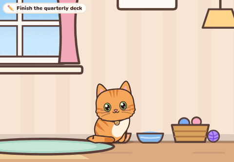
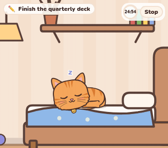
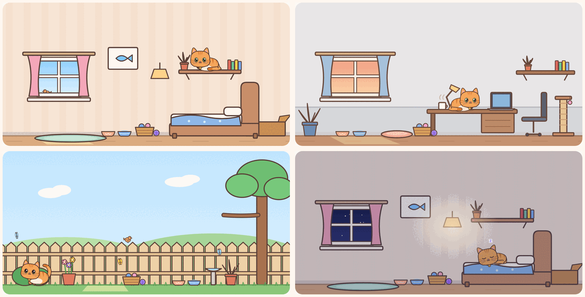
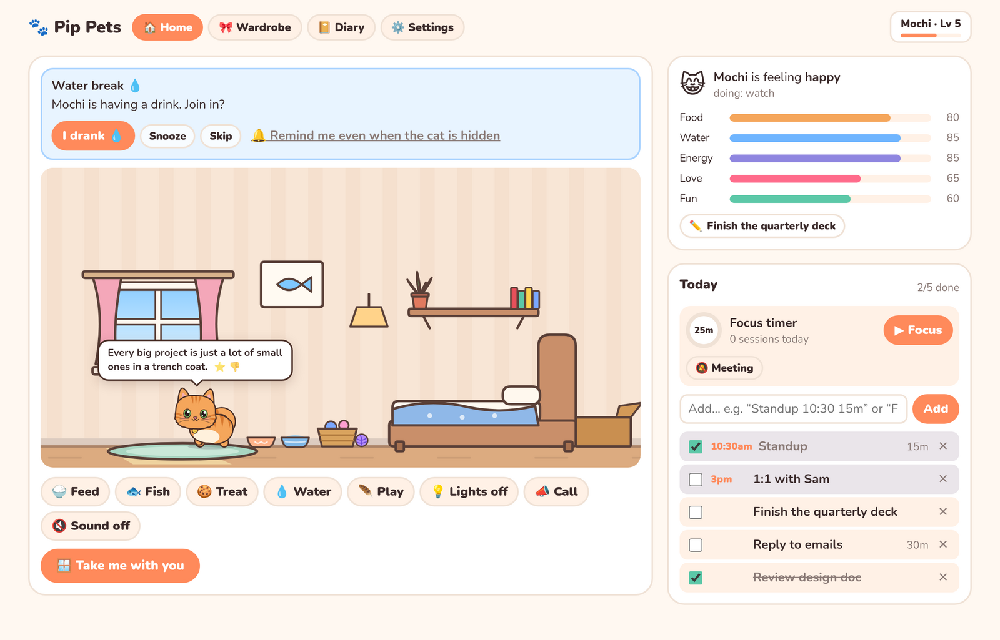
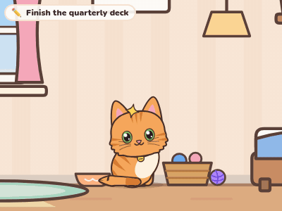
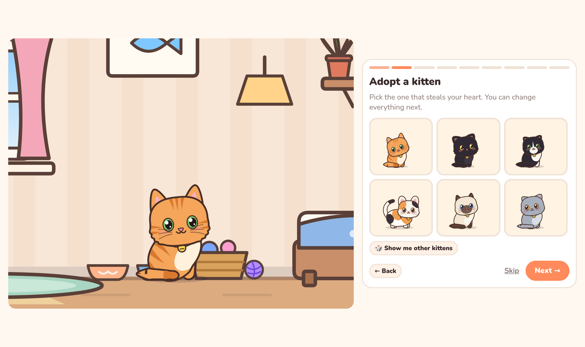
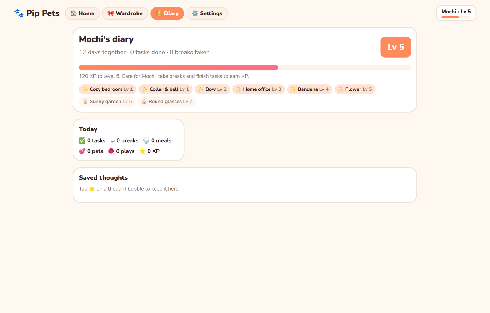

<div align="center">

# 🐾 Pip Pets

### A tiny cat that keeps you company while you work.

It lives in a little always-on-top window in the corner of your screen. It naps while you focus, reminds you about your meetings, stretches with you on breaks, and gets very excited when you check things off your list.

**No install. No account. Just open a tab and adopt.**



<sub>Mochi says good morning, melts into some pets, then trots off for a fish dinner. Every frame is code-drawn SVG, with no sprite sheets.</sub>

</div>

---

## ☕ Why a desk cat?

If your workday is back-to-back calls and a wall of tabs, you probably forget to drink water, skip every break, and only remember the 3pm meeting at 3:04.

Pip Pets puts a small, warm, slightly needy creature in the corner of your screen. Looking after it makes you look after yourself. It runs entirely in your browser, so it works on locked-down work laptops where you can't install anything.

<table>
<tr>
<td width="50%" valign="top">

### 🪟 It comes with you

Click **Take me with you** and your cat hops into a Picture-in-Picture window that floats above your email, docs and video calls. Hover it to feed, water, play, or start a focus session. Stroke it with your cursor to pet it.

</td>
<td width="50%" valign="top">

### 🧘 It keeps you human

Pomodoro focus sessions, stretch breaks, water reminders, 20-20-20 eye breaks, a lunch nudge and a cozy good-night summary. The cat leads each routine, so the breaks actually happen.

</td>
</tr>
</table>

<div align="center">

<br />
<sub>In the PiP window: the cat naps through your focus session, then leads the stretch break.</sub>
</div>

---

## 🏡 A little world to live in

The cat doesn't wander around an empty floor. Each room is full of places it wants to go: it watches birds from the window sill, naps in the sun patch, climbs to the shelf, hides in a box, scratches the post, and co-works next to your laptop. Lighting follows your real clock, from warm morning light to golden hour to a starry night with the lamp on.



<sub>The cozy bedroom, the home office at golden hour, the garden (butterflies to chase!), and bedtime under the stars.</sub>

---

## 💭 It has thoughts (and feelings)

Your cat has five needs: **food, water, energy, love and fun**. It tells you what's missing the way a real cat would, starting subtle and getting louder:

|            | 🐟 Hungry                              | 💧 Thirsty                                       | 🧶 Bored                            | 💕 Lonely                           |
| ---------- | -------------------------------------- | ------------------------------------------------ | ----------------------------------- | ----------------------------------- |
| **Subtle** | sniffs the empty bowl, looks at you    | a little tongue blep, heads for the water bowl   | hunts imaginary bugs, bats the yarn | comes to the front and gazes at you |
| **Clear**  | 🐟 thought bubble, meows at the bowl   | 💧 thought bubble                                | 🧶 thought bubble                   | 💕 thought bubble, slow blinks      |
| **Asking** | _"Food? Please? 🐟"_ + a badge on Feed | _"My water bowl is empty 💧"_ + a badge on Water | _"I'm bored… play with me? 🧶"_     | _"Pet me? 🥺"_                      |

Fix it and you get a happy _"Thank you! 💕"_ with a little burst of hearts.

It also shares **thoughts** through the day, in the vibes you choose: 💪 motivational, 😹 silly cat, 🧘 calm, 🧠 fun facts or 😼 sassy. Some come from your own day (_"3 tasks left, you've got this!"_, _"“1:1 with Sam” in 20 min. Need a quick water break first? 💧"_). Tap ⭐ to save one to the diary, 👎 to see fewer like it. All thoughts go quiet while you focus or are in a meeting.



---

## 🎨 Make it yours

Every cat is drawn from numbers, so there are endless combinations: coat color and pattern (tabby, tuxedo, calico, colorpoint, spotted…), chubbiness, ear shape (yes, Scottish folds), cheek fluff, tail floof, eye shape and color (odd eyes too), and accessories like a collar and bell, bandana, bow, flower crown or tiny round glasses. Then pick a personality: **Sleepy Loaf**, **Velcro**, **Gremlin**, **Diva** or **Explorer**.

<table>
<tr>
<td width="42%" align="center">

<br /><sub>🎲 one cat, many outfits</sub>
</td>
<td width="58%">

<br /><sub>Onboarding starts with adopting one of six live kittens.</sub>
</td>
</tr>
</table>

---

## 🌱 Grows with you

Feeding, petting, playing, finishing tasks and taking breaks all earn **bond XP**. Leveling up unlocks new accessories and new rooms: the home office at level 3, the garden at level 6. The diary keeps a card for each day: tasks done, breaks taken, meals, pets, and thoughts you saved. There's no guilt mechanic: the cat sulks a little if you're away all weekend, but it's always happy to see you on Monday.



---

## 🚀 Try it

```bash
npm install
npm run dev
```

Open http://localhost:5173, adopt a kitten, and click **🪟 Take me with you**.

| Command         | What it does                                                          |
| --------------- | --------------------------------------------------------------------- |
| `npm run dev`   | Dev server with hot reload                                            |
| `npm run build` | Typecheck + production build into `dist/` (static, so any host works) |
| `npm test`      | Unit tests (Vitest)                                                   |
| `npm run lint`  | Oxlint                                                                |

> **Tip:** in dev mode, **Settings → Animation lab** lets you trigger any of the cat's behaviors, scrub the time of day, make it hungry or sleepy, and add XP.

### Browser support

|                              | Picture-in-Picture companion                | Everything else |
| ---------------------------- | ------------------------------------------- | --------------- |
| Chrome / Edge 116+ (desktop) | ✅                                          | ✅              |
| Firefox 151+ (desktop)       | ✅                                          | ✅              |
| Safari, mobile               | ➖ floats in the corner of the page instead | ✅              |

**Two things to know about PiP:**

- **Pin the tab.** Closing the tab closes the cat's window too.
- **Click to reopen.** Browsers only open PiP from a click, so after a reload you'll see a **Resume** button.

### 🔒 Privacy

Everything (your cat, tasks, settings and progress) is stored in **this browser only**. There's no backend and no analytics. The optional "fresh thoughts" feature fetches anonymous quotes and cat facts from [DummyJSON](https://dummyjson.com), [Advice Slip](https://api.adviceslip.com), [catfact.ninja](https://catfact.ninja) and [meowfacts](https://github.com/wh-iterabb-it/meowfacts). Those requests contain nothing about you, and the bundled lines take over if they're blocked. You can export or import a backup from Settings.

---

## 🧶 How it's built

**React 19 + TypeScript + Vite**, on top of a framework-free cat engine. There are almost no image assets: the cat, the rooms, the props, the birds and butterflies, and even the meows and purrs (Web Audio synthesis) are all generated in code.

```
src/
├── engine/                 # the cat simulator (no React inside)
│   ├── appearance.ts       # CatAppearance + Personality: the customization contract
│   ├── anim/               # pose library, spring blending, procedural layers, rig, tail physics
│   ├── behavior/           # 32 behaviors (explore, watch birds, nap, hunt, knead, routines…)
│   ├── sim/                # needs, mood swings, offline catch-up, the hint ladder
│   ├── world/ + scenes/    # rooms, surfaces, navigation & jumping, time of day, critters
│   ├── custom/             # coat-pattern and accessory plugins
│   └── render/             # SVG renderer, follow camera, speech bubbles
├── app/                    # product logic: store, planner, breaks, thoughts, XP
│   └── director.ts         # turns your schedule into cat cues ("stretch with me!")
├── react/                  # PetStage, usePet, usePictureInPicture
└── ui/                     # onboarding, home, wardrobe, diary, settings, PiP companion
```

**A few details:**

- **Animation.** Each pose is a bag of numbers blended with springs. Breathing, blinking, look-at, ear twitches, the walk/gallop cycle and a physics tail are layered on top, so the cat never freezes.
- **Navigation.** Behaviors pick a _place_, not a coordinate. A tiny route planner works out the walk → crouch → leap → land sequence between the floor, bed, sill and shelf.
- **Background tabs.** The PiP window drives its own animation loop, and the day director piggybacks on it, so reminders keep firing when the main tab is in the background.
- **Plugins.** Coat patterns and accessories are self-contained. Adding one doesn't touch the renderer:

```ts
import { registerPattern } from "./src/engine";

registerPattern({
  id: "mittens",
  label: "Mittens",
  paws: ({ color }) => color, // white socks
  head: ({ g, color }) => [{ d: `M-7 ${-g.headRy}h14v10h-14z`, fill: color }], // forehead blaze
});
```

### Regenerating these screenshots

The images and GIFs in this README are real captures of the app, recorded with Playwright:

```bash
npm run dev                          # keep this running
npm i -D playwright-core && npx playwright install chromium
node scripts/capture-media.mjs       # or: hero | break | customize | rooms | pages
```

You'll also need `ffmpeg` and ImageMagick for the GIFs and the room collage.

---

<div align="center">

Made with 🧡 for everyone who forgets to drink water.

</div>
